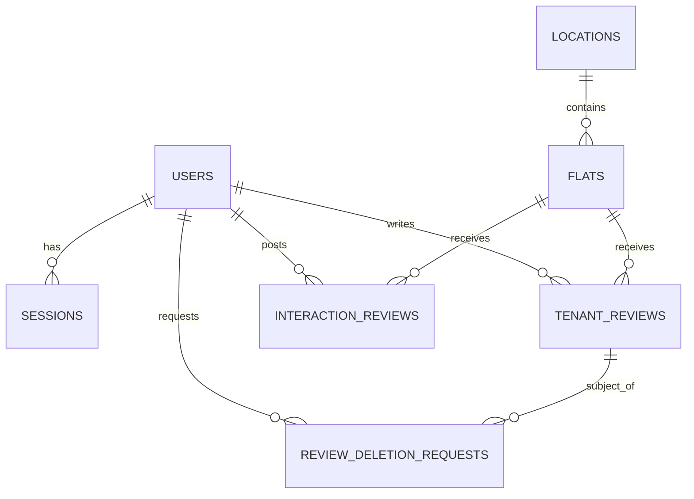

# Rental Review — Database Model

This logical relational model implements [REQUIREMENTS.md](REQUIREMENTS.md). It is database- and ORM-independent; concrete migrations should follow once the application stack is selected. Proposed implementation choices below are distinguished from unresolved product decisions.

## Conventions

- Primary keys are UUIDs named `id`, unless stated otherwise.
- All timestamps represent UTC instants. Calendar dates use `date`.
- Fields are required unless marked nullable. `created_at` defaults to the creation instant; `updated_at` changes when a record is modified.
- Foreign keys restrict physical deletion by default. Deactivation and approved review deletion preserve records and audit history.
- Text described as nonblank must contain at least one non-whitespace character.
- Accounts are identified by Google's stable account id. Account and authentication tables are private.

## Relationships

Rate-limit buckets also cover people who have not signed in yet, so they have no user foreign key.

## Account and authentication tables

### `users`

| Field | Type | Rules |
| --- | --- | --- |
| `id` | UUID | Primary key |
| `google_subject` | string, nullable | Unique Google account id (`sub`); how accounts sign in |
| `email` | string, nullable | Google account email, refreshed on each sign-in; private |
| `role` | enum | `user` or `admin`; default `user` |
| `status` | enum | `active` or `inactive`; default `active` |
| `deactivated_at` | timestamp, nullable | Required exactly when status is `inactive` |
| `created_at` | timestamp | Account creation timestamp |
| `updated_at` | timestamp | Last account modification timestamp |

Accounts sign in with Google (`google_subject`). Accounts left from the removed phone sign-in have no `google_subject` and can no longer sign in; their phone numbers were deleted. No phone numbers, ID numbers or payment details are stored. Tenants and users recording interactions share the same account type; submitting a tenant review does not require a separate role. Additional registration fields are deferred until the corresponding product decision is made. Admin role assignment is privileged and unavailable through self-registration.

### `auth_rate_limits`

| Field | Type | Rules |
| --- | --- | --- |
| `action` | enum | e.g. `google` (sign-in attempts) |
| `subject_kind` | enum | `ip` |
| `subject_digest` | string | Keyed digest of the client IP address |
| `window_started_at` | timestamp | Beginning of configured counting window |
| `window_ends_at` | timestamp | Later than window start |
| `attempt_count` | integer | Nonnegative; increment atomically |
| `blocked_until` | timestamp, nullable | Optional temporary block |

Composite primary key: `(action, subject_kind, subject_digest, window_started_at)`. Limits and window durations remain configurable. An equivalent atomic shared rate-limit store may replace this table once infrastructure is chosen.

### `sessions`

| Field | Type | Rules |
| --- | --- | --- |
| `id` | UUID | Primary key |
| `user_id` | UUID | Foreign key to `users` |
| `token_digest` | string | Unique digest of session token; never store the raw token |
| `created_at` | timestamp | Session creation timestamp |
| `expires_at` | timestamp | Session expiry; must be later than `created_at` |
| `revoked_at` | timestamp, nullable | Non-null sessions cannot authorize access |

Deactivation updates the account and revokes all sessions in one transaction. Authenticated writes must also check current account status. Reactivation requires signing in with the same Google account and explicit confirmation, restores the existing account, and creates a new session; old sessions remain revoked. The unique `google_subject` constraint, plus a per-subject lock, prevents duplicate accounts, including concurrent first sign-ins.

## Property tables

### `locations`

| Field | Type | Rules |
| --- | --- | --- |
| `id` | UUID | Primary key |
| `address` | text | Nonblank display address |
| `building_name` | string, nullable | Optional building label |
| `latitude` | decimal | Between `-90` and `90`, inclusive |
| `longitude` | decimal | Between `-180` and `180`, inclusive |
| `created_at` | timestamp | Record creation timestamp |
| `updated_at` | timestamp | Last record modification timestamp |

A location represents a map marker and may contain multiple flats. Coordinates and addresses are not assumed unique. Geographic coverage, geocoding provider, and location deduplication rules remain unresolved.

### `flats`

| Field | Type | Rules |
| --- | --- | --- |
| `id` | UUID | Primary key |
| `location_id` | UUID | Foreign key to `locations` |
| `label` | string | Nonblank identifier presented to users, such as a flat number |
| `created_at` | timestamp | Record creation timestamp |
| `updated_at` | timestamp | Last record modification timestamp |

Feedback belongs to a flat, not just its building or coordinates. A location marker with multiple flats must allow selection of a flat before showing its two feedback tabs. No uniqueness rule on labels is assumed until property identification is defined.

## Feedback tables

Reviews and interactions name no person: there is no owner field, so no third party's personal data is stored. Nothing is uploaded: there are no file, proof or attachment tables.

### `tenant_reviews`

| Field | Type | Rules |
| --- | --- | --- |
| `id` | UUID | Primary key |
| `author_id` | UUID | Foreign key to `users` |
| `flat_id` | UUID | Foreign key to `flats` |
| `tenancy_start_date` | date | Required start date of the tenancy period being reviewed; immutable |
| `tenancy_end_date` | date | Required end date of the tenancy period being reviewed; immutable |
| `rating` | integer | Check: `1 <= rating <= 5` |
| `feedback` | text | Nonblank written review |
| `submitted_at` | timestamp | Original submission instant; immutable |
| `updated_at` | timestamp | Initially equal to submission; changes on permitted edits |
| `deleted_at` | timestamp, nullable | Set only by approved admin deletion |

Reviews publish immediately; no moderation state is needed. Public visibility is `deleted_at IS NULL` and never depends on the author's account status. Derive the editing deadline as `submitted_at + 30 days` using elapsed UTC time; editing is allowed strictly before that deadline. Only the active author may change `rating` and `feedback`; author, flat, tenancy dates and submission timestamp are immutable.

Represent the tenancy period as `[tenancy_start_date, tenancy_end_date)`: start inclusive, end exclusive, with `tenancy_start_date < tenancy_end_date`. Adjacent periods may share an end/start date. Two periods overlap exactly when `new_start < existing_end AND existing_start < new_end`; this catches identical, partially overlapping, and contained periods.

For a given flat, reject a new tenant review if its tenancy period overlaps a review with a different `author_id` and `deleted_at IS NULL`. Inactive authors and pending/rejected deletion requests still block conflicts; approved deleted reviews do not. Reviews for different flats and interaction reviews do not participate. Multiple reviews by the same author remain allowed.

Serialize tenant-review creation for each flat by locking the existing `flats` row before checking overlaps, then reading the committed conflicting reviews and inserting the review in the same transaction. The check must see submissions committed by the previous lock holder; use an appropriate transaction isolation strategy or a database constraint with equivalent behavior. Every insertion path must enforce this rule, including when no review yet exists for the flat. An index or a check performed only before the transaction cannot prevent concurrent conflicting submissions. Admin deletion approval takes the same flat lock before its request/review locks, using consistent lock ordering, so releasing a period and creating a review are serialized.

No unique `(author_id, flat_id)` constraint is imposed: the requirements do not limit the number of tenant reviews per author and flat. The admin deletion process below is the only supported way to hide a submitted tenant review.

### `interaction_reviews`

| Field | Type | Rules |
| --- | --- | --- |
| `id` | UUID | Primary key |
| `author_id` | UUID | Foreign key to `users` |
| `flat_id` | UUID | Foreign key to `flats` |
| `description` | text | Nonblank description |
| `interaction_date` | date | Date supplied by the author |
| `submitted_at` | timestamp | Original submission instant |

Interactions publish immediately and remain public when the author deactivates. They require neither a tenant review nor a rating. Enforce a database unique constraint on `(author_id, flat_id)` so each user can post at most one interaction review per flat, including under concurrent submissions. Interaction date is not part of the uniqueness key. The same author may review other flats, and different authors may review the same flat. Account deactivation/reactivation does not reset the limit. No interaction editing, deletion, or tenant-review link is introduced while those product decisions remain unresolved.

## Admin deletion table

### `review_deletion_requests`

| Field | Type | Rules |
| --- | --- | --- |
| `id` | UUID | Primary key |
| `tenant_review_id` | UUID | Foreign key to `tenant_reviews` |
| `requested_by` | UUID | Foreign key to `users`; must equal review author |
| `reason` | text | Nonblank author-supplied reason |
| `status` | enum | `pending`, `approved`, or `rejected`; default `pending` |
| `submitted_at` | timestamp | Request submission instant |
| `decided_by` | UUID, nullable | Foreign key to `users`; deciding active admin |
| `decided_at` | timestamp, nullable | Decision timestamp |
| `decision_note` | text, nullable | Optional admin explanation |

Pending requests have no decision fields. Approved or rejected requests require `decided_by` and `decided_at`, with the decision timestamp at or after submission. A decision is final. Proposed duplicate-request policy: at most one pending request per review, while preserving rejected requests and allowing a later request.

Request creation requires an active author and a visible review, independent of the 30-day edit window. Pending and rejected requests leave the review visible. Approval locks the request and review, verifies admin authority, and atomically sets the request to `approved` and the review's `deleted_at` to the decision instant. That removes both feedback and rating from public results and aggregates. Keep the original review and request privately for audit; no tenant-facing physical-delete operation is provided.

FR-08 is modeled for tenant reviews because its removal criteria reference ratings and the Tenant Reviews tab. Extending deletion to interactions awaits the explicitly unresolved interaction-deletion decision.

## Constraints, transactions, and access control

Use database constraints for primary keys, foreign keys, uniqueness, enums, rating and coordinate ranges, nonblank text, nonnegative counters, and timestamp consistency. Cross-table and actor-dependent rules require transactional service logic, database procedures, or triggers; a foreign key alone cannot enforce them.

Required transactional operations:

1. **Google sign-in:** verify the ID token before touching the database, count the attempt against the IP limit even when verification fails, and create or find the account by `google_subject` under a per-subject lock.
2. **Account lifecycle:** create accounts with unique-Google-id conflict handling; revoke sessions on deactivation; reactivate the original account only after confirmation. Serialize lifecycle changes and authenticated writes so an inactive account cannot continue writing with an old session.
3. **Review submission:** verify active author, validate the flat and tenancy dates, lock the flat and reject overlaps with another author's non-deleted tenant reviews, and insert the review. Interaction submission likewise validates the flat and inserts the interaction, enforcing unique `(author_id, flat_id)`. Translate a violation of this constraint into the duplicate-interaction conflict response and roll back the submission; a preliminary existence check alone is insufficient.
4. **Review edit:** enforce author identity, current active status, visibility, and `current_time < submitted_at + 30 days` within the write operation, not just in the UI.
5. **Deletion request/decision:** validate authorship on request creation and admin role on decision; serialize competing decisions and update deletion visibility atomically, taking the flat lock first so approval also releases the tenancy period consistently with submissions.

Public queries should use explicit field allowlists or database views and expose only location, flat, rating, feedback/description, tenancy dates, interaction date, and relevant review timestamps/IDs. Do not join or serialize private account, authentication, or deletion-request fields into public responses. Administrative and self-service endpoints require separate authorization.

## Query paths and indexes

In addition to primary-key and unique indexes, add indexes on foreign keys used for retrieval and these access paths:

| Query | Index or retrieval rule |
| --- | --- |
| Sign-in and reactivation | Unique `users(google_subject)` |
| Expired rate-limit cleanup | `auth_rate_limits(window_ends_at)` |
| Revoke account sessions | `sessions(user_id, revoked_at)`; expiry cleanup on `expires_at` |
| Flats at a marker | `flats(location_id)` |
| Tenant period conflict check | `tenant_reviews(flat_id, tenancy_start_date, tenancy_end_date)` filtered to `deleted_at IS NULL`, where supported; compare author IDs and period overlap under the flat lock |
| Public tenant review tab | `tenant_reviews(flat_id, submitted_at, id)` filtered to `deleted_at IS NULL`, where supported |
| Public interaction tab | `interaction_reviews(flat_id, submitted_at, id)` |
| One interaction review per user per flat | Unique `interaction_reviews(author_id, flat_id)` |
| Author's records | Each review table on `(author_id, submitted_at, id)` |
| Pending admin queue | `review_deletion_requests(status, submitted_at, id)` |
| Author's deletion requests | `review_deletion_requests(requested_by, submitted_at, id)` |
| Prevent duplicate pending requests | Unique filtered index on `tenant_review_id` where `status = 'pending'`, or equivalent transactional enforcement |
| Map viewport | Spatial index on a point derived from location coordinates if supported; otherwise indexed bounding-box filtering appropriate to the chosen database |

A map location qualifies when at least one of its flats has a visible tenant review **or** an interaction review. Use `EXISTS` or a union of qualifying location IDs to avoid duplicates and inflated rating counts from joining both review tables. Interaction-only locations must appear. Compute tenant rating aggregates only from visible tenant reviews; return no rating when none exist. Deleting a location's final visible tenant review removes its marker only if it has no interaction reviews either.

Public retrieval never filters by author account status. Use stable pagination ordered by submission time and ID. Nearby-point search and its radius remain deferred; viewport and selected-marker lookup are supported by the model.

## Requirement coverage

| Requirement | Model support |
| --- | --- |
| FR-01: Google sign-in | `users`, `auth_rate_limits`, `sessions` |
| FR-02: Deactivation and reactivation | Account status, session revocation, unique Google identity, author-independent public visibility |
| FR-04: Tenant reviews | `tenant_reviews`, tenancy periods with atomic conflict checks across different authors per flat, immutable submission time and derived editing deadline |
| FR-05: Map search | `locations`, `flats`, visibility union across both review types |
| FR-06: Public interactions | `interaction_reviews` with unique `(author_id, flat_id)`, separate public projection |
| FR-07: Separate tabs | Independent review tables linked directly to the same flat |
| FR-08: Admin deletion | `review_deletion_requests`, transactional approval, logical review deletion |

## Decisions still needed

The unresolved decisions in `REQUIREMENTS.md` remain open: extra registration fields; interaction edit/delete/link behavior; location/flat creation and deduplication; nearby-search behavior; and map provider/coverage.

Implementation must also set retention periods for authentication data and private audit records. The model does not introduce review pre-approval or a one-review-per-flat limit.
