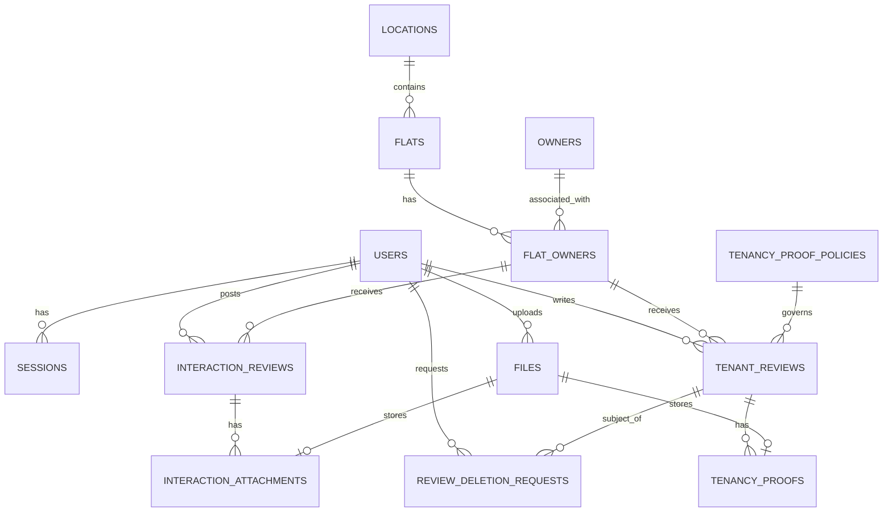

# Rental Review — Database Model

This logical relational model implements [REQUIREMENTS.md](REQUIREMENTS.md). It is database- and ORM-independent; concrete migrations should follow once the application stack is selected. Proposed implementation choices below are distinguished from unresolved product decisions.

## Conventions

- Primary keys are UUIDs named `id`, unless stated otherwise.
- All timestamps represent UTC instants. Calendar dates use `date`.
- Fields are required unless marked nullable. `created_at` defaults to the creation instant; `updated_at` changes when a record is modified.
- Foreign keys restrict physical deletion by default. Deactivation and approved review deletion preserve records and audit history.
- Text described as nonblank must contain at least one non-whitespace character.
- Phone numbers are normalized to E.164 before storage and uniqueness checks. Account and authentication tables are private.
- Files live in private object storage; the database stores metadata and opaque storage keys, never file contents or permanent public URLs.

## Relationships

OTP challenges and rate-limit buckets also support users who have not registered, so neither requires a user foreign key.

## Account and authentication tables

### `users`

| Field | Type | Rules |
| --- | --- | --- |
| `id` | UUID | Primary key |
| `mobile_number` | string | Unique normalized E.164 number; private |
| `mobile_verified_at` | timestamp | Set from successful OTP verification before account creation |
| `role` | enum | `user` or `admin`; default `user` |
| `status` | enum | `active` or `inactive`; default `active` |
| `deactivated_at` | timestamp, nullable | Required exactly when status is `inactive` |
| `created_at`, `updated_at` | timestamp | Account lifecycle timestamps |

Tenants and users recording interactions share the same account type; submitting a tenant review does not require a separate role. Additional registration fields are deferred until the corresponding product decision is made. Admin role assignment is privileged and unavailable through self-registration.

### `otp_challenges`

| Field | Type | Rules |
| --- | --- | --- |
| `id` | UUID | Primary key; random challenge identifier |
| `mobile_number` | string | Normalized E.164 number; private |
| `code_digest` | string | Keyed digest of challenge ID and code; secret key held outside the database |
| `delivery_status` | enum | `pending`, `sent`, or `failed` |
| `provider_message_id` | string, nullable | Private SMS provider reference |
| `failure_code` | string, nullable | Sanitized delivery error code; no OTP or message body |
| `attempt_count` | integer | Default `0`; nonnegative |
| `max_attempts` | integer | Positive; snapshot of configured verification limit |
| `created_at`, `expires_at` | timestamp | Expiry must be later than creation |
| `resend_available_at` | timestamp | Earliest replacement request allowed by cooldown |
| `consumed_at` | timestamp, nullable | Set atomically on successful verification |
| `invalidated_at` | timestamp, nullable | Set when replaced or otherwise revoked |
| `completion_token_digest` | string, nullable | Unique digest of a short-lived continuation token after successful verification |
| `completion_expires_at` | timestamp, nullable | Expiry of the continuation token |
| `completed_at` | timestamp, nullable | Set when verification is used to finish sign-in, registration, or reactivation |

Never persist or log plaintext OTPs. A keyed digest protects low-entropy codes against offline enumeration from a database-only compromise. Verification must check expiry, invalidation, consumption, and attempt limits and atomically increment failed attempts or consume a valid code. Serialize issuance per phone number so replacement invalidates all preceding usable challenges, including under concurrent requests.

A successful verification can finish sign-in immediately or issue a short-lived, single-use continuation token for missing registration details or explicit reactivation confirmation. Store its digest and expiry together. Completion must atomically check and consume that token; it must not reuse the OTP. Failed delivery supports a fresh request within cooldown and rate limits. Expiry, cooldown, and attempt settings are deployment configuration, with no product values assumed here.

### `auth_rate_limits`

| Field | Type | Rules |
| --- | --- | --- |
| `action` | enum | `otp_request` or `otp_verify` |
| `subject_kind` | enum | `mobile` or `ip` |
| `subject_digest` | string | Keyed digest of normalized phone number or IP address |
| `window_started_at` | timestamp | Beginning of configured counting window |
| `window_ends_at` | timestamp | Later than window start |
| `attempt_count` | integer | Nonnegative; increment atomically |
| `blocked_until` | timestamp, nullable | Optional temporary block |

Composite primary key: `(action, subject_kind, subject_digest, window_started_at)`. Enforce request and verification limits across challenges so requesting replacement codes cannot reset them. Limits and window durations remain configurable. An equivalent atomic shared rate-limit store may replace this table once infrastructure is chosen.

### `sessions`

| Field | Type | Rules |
| --- | --- | --- |
| `id` | UUID | Primary key |
| `user_id` | UUID | Foreign key to `users` |
| `token_digest` | string | Unique digest of session token; never store the raw token |
| `created_at`, `expires_at` | timestamp | Expiry later than creation |
| `revoked_at` | timestamp, nullable | Non-null sessions cannot authorize access |

Deactivation updates the account and revokes all sessions in one transaction. Authenticated writes must also check current account status. Reactivation requires verified possession of the registered number and explicit confirmation, restores the existing account, and creates a new session; old sessions remain revoked. The unique phone constraint prevents duplicate accounts, including concurrent registration attempts.

## Owner and property tables

### `owners`

| Field | Type | Rules |
| --- | --- | --- |
| `id` | UUID | Primary key |
| `display_name` | string | Nonblank public owner name; not unique |
| `created_at`, `updated_at` | timestamp | Record timestamps |

An owner is the subject of feedback and need not have a user account. A name alone is not a reliable identity or deduplication key.

### `locations`

| Field | Type | Rules |
| --- | --- | --- |
| `id` | UUID | Primary key |
| `address` | text | Nonblank display address |
| `building_name` | string, nullable | Optional building label |
| `latitude` | decimal | Between `-90` and `90`, inclusive |
| `longitude` | decimal | Between `-180` and `180`, inclusive |
| `created_at`, `updated_at` | timestamp | Record timestamps |

A location represents a map marker and may contain multiple flats. Coordinates and addresses are not assumed unique. Geographic coverage, geocoding provider, and location deduplication rules remain unresolved.

### `flats`

| Field | Type | Rules |
| --- | --- | --- |
| `id` | UUID | Primary key |
| `location_id` | UUID | Foreign key to `locations` |
| `label` | string | Nonblank identifier presented to users, such as a flat number |
| `created_at`, `updated_at` | timestamp | Record timestamps |

Feedback belongs to a flat, not just its building or coordinates. A location marker with multiple flats must allow selection of a flat before showing its two feedback tabs. No uniqueness rule on labels is assumed until property identification is defined.

### `flat_owners`

| Field | Type | Rules |
| --- | --- | --- |
| `id` | UUID | Primary key |
| `flat_id` | UUID | Foreign key to `flats` |
| `owner_id` | UUID | Foreign key to `owners` |
| `created_at` | timestamp | Association creation timestamp |

Unique pair: `(flat_id, owner_id)`. This association supports owners with multiple properties and different reviewed owners for the same flat. Both review types reference it so their flat and owner cannot disagree. Once referenced, its owner and flat are immutable; retain historical associations rather than reassigning existing reviews when ownership changes. This is a feedback association, not a verified legal ownership register.

## Feedback and file tables

### `tenancy_proof_policies`

| Field | Type | Rules |
| --- | --- | --- |
| `id` | UUID | Primary key |
| `proof_required` | boolean | Seed initial policy with `false` |
| `effective_from` | timestamp | Unique start instant |
| `created_at` | timestamp | Policy creation timestamp |

Policies are immutable versions managed by privileged configuration. The latest policy effective at submission applies to a new tenant review. Record that version on the review; a future mandatory policy does not retroactively invalidate previously accepted reviews.

### `tenant_reviews`

| Field | Type | Rules |
| --- | --- | --- |
| `id` | UUID | Primary key |
| `author_id` | UUID | Foreign key to `users` |
| `flat_owner_id` | UUID | Foreign key to `flat_owners` |
| `rating` | integer | Check: `1 <= rating <= 5` |
| `feedback` | text | Nonblank written review |
| `proof_policy_id` | UUID | Foreign key to `tenancy_proof_policies`; fixed at submission |
| `submitted_at` | timestamp | Original submission instant; immutable |
| `updated_at` | timestamp | Initially equal to submission; changes on permitted edits |
| `deleted_at` | timestamp, nullable | Set only by approved admin deletion |

Reviews publish immediately; no moderation state is needed. Public visibility is `deleted_at IS NULL` and never depends on the author's account status. Derive the editing deadline as `submitted_at + 30 days` using elapsed UTC time; editing is allowed strictly before that deadline. Only the active author may change `rating` and `feedback`; author, association, submission timestamp, and policy are immutable.

No unique `(author_id, flat_owner_id)` constraint is imposed: the requirements do not limit the number of tenant reviews per author and flat. The admin deletion process below is the only supported way to hide a submitted tenant review.

### `interaction_reviews`

| Field | Type | Rules |
| --- | --- | --- |
| `id` | UUID | Primary key |
| `author_id` | UUID | Foreign key to `users` |
| `flat_owner_id` | UUID | Foreign key to `flat_owners` |
| `description` | text | Nonblank description |
| `interaction_date` | date | Date supplied by the author |
| `submitted_at` | timestamp | Original submission instant |

Interactions publish immediately and remain public when the author deactivates. They require neither a tenant review nor a rating. Multiple interactions for the same owner and flat are allowed. No interaction editing, deletion, or tenant-review link is introduced while those product decisions remain unresolved. Attachment changes do not change the interaction itself.

### `files`

| Field | Type | Rules |
| --- | --- | --- |
| `id` | UUID | Primary key |
| `uploader_id` | UUID | Foreign key to `users` |
| `purpose` | enum | `tenancy_proof` or `interaction_support` |
| `storage_key` | string | Unique opaque object-storage key; private |
| `original_filename` | string | Private metadata; sanitize before any display |
| `media_type` | string | Validated MIME type |
| `size_bytes` | integer | Positive file size |
| `status` | enum | `pending`, `ready`, `rejected`, `deletion_pending`, or `deleted` |
| `created_at`, `updated_at` | timestamp | Upload lifecycle timestamps |
| `deleted_at` | timestamp, nullable | Set when stored object deletion completes |

Only `ready` files can be attached. File type and size limits are configuration decisions. Proposed file lifecycle separates database changes from object-storage operations: retry failed object deletion and clean up expired unattached uploads. Attachment removal takes effect immediately even if physical object deletion is pending.

### `tenancy_proofs`

| Field | Type | Rules |
| --- | --- | --- |
| `id` | UUID | Primary key |
| `tenant_review_id` | UUID | Foreign key to `tenant_reviews` |
| `file_id` | UUID | Unique foreign key to `files` |
| `created_at` | timestamp | Association creation timestamp |

Proof files must have purpose `tenancy_proof` and belong to the review author. Proof content and metadata are private and excluded from all public review responses. When the effective policy requires proof, creating a review and associating at least one ready proof must succeed atomically. No proof approval workflow is required by the current requirements.

### `interaction_attachments`

| Field | Type | Rules |
| --- | --- | --- |
| `id` | UUID | Primary key |
| `interaction_review_id` | UUID | Foreign key to `interaction_reviews` |
| `file_id` | UUID | Unique foreign key to `files` |
| `created_at` | timestamp | Attachment creation timestamp |
| `removed_at` | timestamp, nullable | Non-null attachments are no longer available on the review |

Files must have purpose `interaction_support` and belong to the interaction author. Enforce one attachment association per file across both attachment tables, using purpose validation and transactional checks or database triggers. Only the signed-in active author can attach or remove files, both during posting and afterward. Removing an attachment leaves its interaction review intact.

The requirements make interaction text public but do not explicitly define supporting-file download visibility. Until that is decided, file access defaults to the author; exposing supporting files publicly requires an explicit access policy. Tenancy proofs always remain private.

## Admin deletion table

### `review_deletion_requests`

| Field | Type | Rules |
| --- | --- | --- |
| `id` | UUID | Primary key |
| `tenant_review_id` | UUID | Foreign key to `tenant_reviews` |
| `requested_by` | UUID | Foreign key to `users`; must equal review author |
| `reason` | text | Nonblank author-supplied reason |
| `status` | enum | `pending`, `approved`, or `rejected`; default `pending` |
| `submitted_at` | timestamp | Request submission instant |
| `decided_by` | UUID, nullable | Foreign key to `users`; deciding active admin |
| `decided_at` | timestamp, nullable | Decision timestamp |
| `decision_note` | text, nullable | Optional admin explanation |

Pending requests have no decision fields. Approved or rejected requests require `decided_by` and `decided_at`, with the decision timestamp at or after submission. A decision is final. Proposed duplicate-request policy: at most one pending request per review, while preserving rejected requests and allowing a later request.

Request creation requires an active author and a visible review, independent of the 30-day edit window. Pending and rejected requests leave the review visible. Approval locks the request and review, verifies admin authority, and atomically sets the request to `approved` and the review's `deleted_at` to the decision instant. That removes both feedback and rating from public results and aggregates. Keep the original review and request privately for audit; no tenant-facing physical-delete operation is provided.

FR-08 is modeled for tenant reviews because its removal criteria reference ratings and the Tenant Reviews tab. Extending deletion to interactions awaits the explicitly unresolved interaction-deletion decision.

## Constraints, transactions, and access control

Use database constraints for primary keys, foreign keys, uniqueness, enums, rating and coordinate ranges, nonblank text, nonnegative counters, and timestamp consistency. Cross-table and actor-dependent rules require transactional service logic, database procedures, or triggers; a foreign key alone cannot enforce them.

Required transactional operations:

1. **OTP issuance and verification:** enforce shared limits and cooldowns, invalidate replaced challenges, and atomically consume successful codes and continuation tokens. SMS delivery occurs outside the transaction with persisted delivery outcomes.
2. **Account lifecycle:** complete verified registration with unique-phone conflict handling; revoke sessions on deactivation; reactivate the original account only after confirmation. Serialize lifecycle changes and authenticated writes so an inactive account cannot continue writing with an old session.
3. **Review submission:** verify active author, select the effective proof policy, validate files, and insert the review and any proof associations together. Do not trust a client-supplied policy version.
4. **Review edit:** enforce author identity, current active status, visibility, and `current_time < submitted_at + 30 days` within the write operation, not just in the UI.
5. **File attachment/removal:** check account status, review authorship, file ownership, purpose, and lifecycle state. Recheck authorization when a completed upload becomes attached.
6. **Deletion request/decision:** validate authorship on request creation and admin role on decision; serialize competing decisions and update deletion visibility atomically.

Public queries should use explicit field allowlists or database views and expose only location, flat, owner, rating, feedback/description, interaction date, and relevant review timestamps/IDs. Do not join or serialize private account, authentication, proof, storage-key, or deletion-request fields into public responses. Administrative and self-service endpoints require separate authorization.

## Query paths and indexes

In addition to primary-key and unique indexes, add indexes on foreign keys used for retrieval and these access paths:

| Query | Index or retrieval rule |
| --- | --- |
| Sign-in and reactivation | Unique `users(mobile_number)` |
| Latest phone challenge | `otp_challenges(mobile_number, created_at)` |
| OTP and continuation cleanup | `otp_challenges(expires_at)` and `completion_expires_at` |
| Expired rate-limit cleanup | `auth_rate_limits(window_ends_at)` |
| Revoke account sessions | `sessions(user_id, revoked_at)`; expiry cleanup on `expires_at` |
| Flats at a marker | `flats(location_id)` |
| Owners for a flat | Unique `flat_owners(flat_id, owner_id)`; additional `flat_owners(owner_id)` |
| Public tenant review tab | `tenant_reviews(flat_owner_id, submitted_at, id)` filtered to `deleted_at IS NULL`, where supported |
| Public interaction tab | `interaction_reviews(flat_owner_id, submitted_at, id)` |
| Author's records | Each review table on `(author_id, submitted_at, id)` |
| Active interaction attachments | `interaction_attachments(interaction_review_id, removed_at)` |
| Proof lookup | `tenancy_proofs(tenant_review_id)` |
| Pending admin queue | `review_deletion_requests(status, submitted_at, id)` |
| Author's deletion requests | `review_deletion_requests(requested_by, submitted_at, id)` |
| Prevent duplicate pending requests | Unique filtered index on `tenant_review_id` where `status = 'pending'`, or equivalent transactional enforcement |
| Map viewport | Spatial index on a point derived from location coordinates if supported; otherwise indexed bounding-box filtering appropriate to the chosen database |

A map location qualifies when at least one of its flat-owner associations has a visible tenant review **or** an interaction review. Use `EXISTS` or a union of qualifying location IDs to avoid duplicates and inflated rating counts from joining both review tables. Interaction-only locations must appear. Compute tenant rating aggregates only from visible tenant reviews; return no rating when none exist. Deleting a location's final visible tenant review removes its marker only if it has no interaction reviews either.

Public retrieval never filters by author account status. Use stable pagination ordered by submission time and ID. Nearby-point search and its radius remain deferred; viewport and selected-marker lookup are supported by the model.

## Requirement coverage

| Requirement | Model support |
| --- | --- |
| FR-01: Registration and OTP sign-in | `users`, `otp_challenges`, `auth_rate_limits`, `sessions` |
| FR-02: Deactivation and reactivation | Account status, session revocation, unique phone identity, author-independent public visibility |
| FR-04: Tenant reviews | `tenant_reviews`, versioned proof policies, private proofs, immutable submission time and derived editing deadline |
| FR-05: Map search | `locations`, `flats`, `flat_owners`, visibility union across both review types |
| FR-06: Public interactions | `interaction_reviews`, `files`, `interaction_attachments`, separate public projection |
| FR-07: Separate tabs | Independent review tables joined through the same flat-owner association |
| FR-08: Admin deletion | `review_deletion_requests`, transactional approval, logical review deletion |

## Decisions still needed

The unresolved decisions in `REQUIREMENTS.md` remain open: extra registration fields; SMS provider, countries, expiry, cooldown, and limits; interaction edit/delete/link behavior; owner/property creation and deduplication; nearby-search behavior; and map provider/coverage.

Implementation must also select a database/ORM, define file size/type and supporting-file access policies, and set retention periods for authentication data, detached uploads, and private audit records. The model does not introduce tenancy-proof verification, mandatory proof by default, review pre-approval, or a one-review-per-flat limit.
