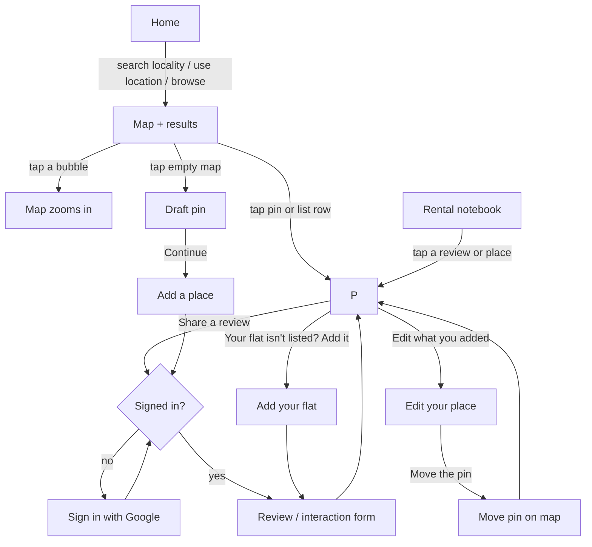

# Rental Review UI workflow

How people move through the web app at <https://rentalreview.boringman.in>
(`fronend/webUI`). The visual rules (colours, type, components) are in
[design-system/rental-review/MASTER.md](design-system/rental-review/MASTER.md). The API
behind every step is in [API_CONTRACTS.md](API_CONTRACTS.md).

Anyone can browse and read. Writing anything (a review, an interaction, a new place
or flat) needs **Google sign-in**. The app remembers what you were doing and resumes it
after you sign in.

## Screens

| Screen | Primary task | Main actions |
| --- | --- | --- |
| Home | Start looking | Search a locality; use my location; browse the map |
| Map + results | Explore an area | Pan or zoom; sort the list; open a place; tap empty map to add a place |
| Place details | Read about one building | Pick a flat; switch Tenant Reviews / Interactions; share; add a flat; edit what you added |
| Add a place | Put a missing building on the map | Drag the draft pin; review nearby places; enter name, address, flat |
| Add your flat | Add a flat to an existing building | Enter the flat number, then go straight to the review form |
| Share a review / interaction | Record an experience | Rating, owner name, tenancy dates, text, optional proof or file |
| Edit your place | Fix what you added | Rename, re-address, move the pin, relabel your flat |
| Sign in | Get an account | Continue with Google (one tap); confirm reactivation if deactivated |
| Rental notebook | Manage your own records | Name; places you added; your reviews and interactions; deletion requests; deactivate |
| How it works | Understand the two kinds of feedback | Read; close |

The top bar is always present: the brand (links home), a compact search once you're on the map,
**How it works** (home page only), and **Sign in** when signed out or, when signed in, a round
gold avatar with the first letter of your name (or email). Screen readers announce it as "Your account".

## Layout by screen size

| Width | Map + results | Dialogs |
| --- | --- | --- |
| Desktop and large tablet (> 860 px) | Full-bleed map; a 408 px panel floats over its left edge. The map treats the area under the panel as hidden, so counts, "nearest" and centring use only the visible part | Centred, max ~560 px |
| Small tablet and phone (≤ 860 px) | Map fills the top 44% of the screen; results become a sheet below it with a grab handle; the whole page scrolls | Full-width sheet on phones (< 600 px) |

The URL always holds the current state (`?at=lat,lng,zoom&area=…&place=…&flat=…`), so
**refresh, back/forward and shared links reopen the same spot, place and flat**. The logo
returns home.

## Core flows

### 1. Find a place

1. **Search:** suggestions are localities only; buildings are found on the map or in the list.
   - **Before typing**, the box lists the nearest neighbourhoods: "Areas near the map centre" on
     the map, "Areas near you" on the home page if you have already allowed location access
     (it never asks just for this), otherwise "Areas in Bengaluru".
   - **While typing**, matches are ranked by distance from that same point ("Na" near JP Nagar
     gives Nagarabhavi, not Nagpur). Arrow keys move through them and Enter picks one.
2. **Pick a locality:** the map opens on it and the list shows places in the visible area,
   20 at a time, loading more as you scroll ("Loading more places…").
3. **Area and counts:** the area you're exploring shows as a chip in the topbar, beside your
   profile ("📍 JP Nagar"; just the pin on phones). Tap it to search for another area. The panel
   opens with the sort menu and a **✕** to hide it; the place count is not shown but is announced to
   screen readers ("N places in this area · M experiences"). When the area holds more than the
   500 places a view loads, map bubbles show rounded-down counts with `+`. **Zoom in** for exact
   numbers.
4. **Sort:** Nearest to map centre (default) · Highest rated · Most reviewed.
5. **Bubbles:** pins group into bubbles. Tapping a bubble zooms in, and at full zoom every
   building has its own pin.
6. **Hovering a list row** highlights its pin (or its bubble), and the reverse works too.
7. The **✕** at the top right of the panel ("Hide list" / "Hide details" for screen readers) hides the results or details to show more map; counts and
   "nearest" then use the whole map. **Show list · N places** (top-left; bottom-centre on phones)
   brings it back, and tapping a pin reopens it with that place. The choice is remembered.

### 2. Read about a place

1. **Header:** building name, address, then Rating · Reviews · Interactions tiles.
2. **Select a flat:** reviews belong to one flat, never mixed. The last-used or newly added flat is preselected.
3. **Tabs:** **Tenant Reviews** (rating, tenancy dates, feedback) and **Interactions**
   (viewings and conversations with no tenancy). Each tab shows its count, and arrow keys switch tabs.
4. **Feedback cards** show the owner name, rating, dates and text. Author identity, emails and
   proof files are never shown.

### 3. Share an experience (signed in)

1. **Share a review** / **Share an interaction** opens the form for the selected flat.
2. **Tenant review:** rating 1–5, owner name, tenancy start and end (end after start, no
   overlap with another tenant's period on this flat), feedback, and proof of tenancy
   (optional or required depending on the current policy).
3. **Interaction:** owner name, date, what happened, optional supporting file. One per
   person per flat.
4. **After publishing:** toast "Thanks for sharing. Your experience is now public." and the
   list refreshes. Errors (such as an overlapping period) appear in the form, which keeps what you typed.

### 4. Add a missing building

1. **Tap empty map**: a draggable **+ New** pin appears with
   "Add a new place here?" → **Cancel** / **Continue**.
2. **Already on the map nearby** lists places within 100 m, each with **Review this place**,
   to prevent duplicates.
3. **Form:** building name (required when places are nearby, otherwise optional), address and flat.
   The server rejects a duplicate (the same name within 100 m, or an unnamed pin within 30 m)
   with a clear message.
4. **Add place and write a review:** the place is created and the review form opens straight away.

### 5. Edit what you added

- On a place you created, **Edit what you added** opens **Edit your place**: building name,
  address, and your flat's number. **Move the pin on the map** enters move mode
  ("Drag the pin, or tap the map, then save" → **Save pin**).
- **Editing locks** once someone else reviews it, posts an interaction, or adds a flat there.
  Seeded and older places have no creator and stay read-only.
- **Your own reviews** get an **Edit** pill (rating and feedback) for 30 days. The card says
  "Your review · editable until …".

### 6. Sign in

- **Continue with Google** is the only method (one tap, then the dialog closes and the pending action resumes).
- **Deactivated account:** "Welcome back" → **Reactivate my account**.
- **Google not configured or unreachable:** "Google sign-in isn't available right now".

### 7. Rental notebook (Your account)

- **Header:** your name (**Edit name** / **Add your name**, private, never on reviews; "Use my
  Google name" resets it) and your email, plus **Sign out**.
- **Places you added:** "You added this building" or "You added a flat here".
- **Your tenant reviews** and **Your interactions:** each starts with "Building · Flat X" and
  address. **Tap it to open that place with the flat and tab selected.** Actions: Edit review (30 days),
  Request deletion (an admin decides, and the review stays visible until approved), Manage supporting files.
- **Deletion requests** with their status. Admins also see **Pending deletion requests**
  (Approve / Reject).
- **Deactivate account:** explains that reviews stay public, then confirms.

## States to design for

| State | What the user sees |
| --- | --- |
| Loading the area | "Loading…" in the panel count (no list flash for fast responses) |
| Loading more | "Loading more places…" under the list (live region) |
| Empty area | "No places in this area. Move the map to another area, or tap it to add a place here." |
| Capped area | "500 places+" and `N+` bubbles: zoom in for exact data |
| No reviews on a flat | "No tenant reviews yet / Be the first to share your experience with this flat." |
| Network or server error | Inline `role="alert"` message with a retry; the list keeps its last data |
| Session ended | Toast "Your session has ended. Please sign in again."; actions re-prompt for sign-in |
| Geolocation denied | "We couldn't get your location. Search for a locality instead." |

## Accessibility

- **Map alternative:** the results list is the accessible alternative to the map, with the same places and actions.
- **Keyboard:** every action works by keyboard. Dialogs trap focus and Esc closes them.
- **Labels:** visible form labels. Errors are announced and placed next to their field.
- **Screen readers:** rating colour always comes with its number. Bubble counts read "At least 300 places" when partial.
- **Motion and touch:** reduced motion is respected. Touch targets are at least 44 px.

## Recommended next improvements

Ordered by impact on how trustworthy the app feels.

1. **Server-side area counts and sorting.** This removes the 500-place cap, so "nearest" and
   "highest rated" cover the whole area and bubbles show true counts.
2. **Skeleton rows** while an area loads, matching the place-row shape.
3. **Verified-tenant badge** on reviews that included proof of tenancy (a small blue check
   using `--info`), the strongest trust signal for readers.
4. **Filter chips** above the list: *Has reviews* · *4★+* · *Has interactions*.
5. **Dark mode** using the token set in MASTER.md, with every colour pair re-checked.
6. **Mobile app:** the same flows in React Native, with the map on MapLibre. See the
   discussion of MapLibre in the project notes.
